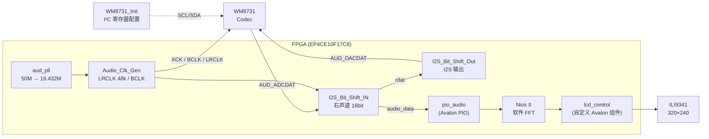

# AC620_LCD9341_audio

基于 **Cyclone IV E** 的 FPGA 音频采集回放 + 实时频谱显示实验（AC620 开发板）。

音频经 WM8731 编解码器以 I2S 方式采集，FPGA 内部完成硬件直通输出，同时把 16 bit PCM 数据送到 Nios II，由软件做 256 点 FFT 并在 ILI9341 液晶屏上绘制频谱柱状图。

---

## 硬件平台

| 项目 | 参数 |
|---|---|
| 开发板 | AC620（小梅哥 / 芯路恒） |
| FPGA | Cyclone IV E **EP4CE10F17C8**（256 引脚，速度等级 8） |
| 系统时钟 | 50 MHz（`clk`） |
| 音频编解码 | WM8731（I2S + I²C 配置） |
| 显示屏 | ILI9341，320×240，16 bit 8080 并口 |
| 存储 | 板载 SDRAM（Avalon-MM 控制器，100 MHz） |
| 软核 | Nios II / gen2 |

---

## 系统架构



数据通路有两条：

1. **硬件直通**：ADC 采集 → `I2S_Bit_Shift_IN` → `I2S_Bit_Shift_Out` → DAC，纯组合/寄存器路径，不经过 CPU，延迟极低。这就是"边录边放"听到的实时声音。
2. **软件分析**：同一份 PCM 数据经 `pio_audio` 送进 Nios II，CPU 采集 256 点做基 2 FFT，算幅度谱后由 `lcd_control` 写到屏幕上。

---

## 关键参数

| 参数 | 取值 | 出处 |
|---|---|---|
| 系统时钟 | 50 MHz | `AC620_GHRD.sdc`：`create_clock -period 20.000` |
| 音频主时钟 XCK | 18.432 MHz | `aud_pll` + `Audio_Clk_Gen.CLOCK_REF` |
| 采样率 | 48 kHz | `Audio_Clk_Gen.CLOCK_SAMPLE = 48000` |
| 量化位宽 | 16 bit | I2S 移位寄存器 |
| 声道 | **仅右声道**采集 | `I2S_Bit_Shift_IN.rdat` |
| SDRAM 时钟 | 100 MHz（50M ×2，-90° 相位） | Qsys `altpll_0` |
| FFT 点数 | 256 | `software/audio_test/hello_world.c` |
| 频谱刷新率 | ≈ 20 Hz | `usleep(50000)` |
| 工具链 | Quartus 17.1 Standard + Nios II EDS | `AC620_GHRD.qsf` |

---

## 目录结构

```
.
├── AC620_GHRD.qpf / .qsf        # Quartus 工程（顶层 AC620_GHRD）
├── AC620_GHRD.v                 # 顶层：例化 Qsys 系统 + 音频模块
├── AC620_GHRD.sdc               # 时序约束
├── mysystem.qsys                # Qsys 系统（Nios II / SDRAM / PIO / UART / EPCS）
├── rtl/
│   ├── Audio_Record_Play.v      # 音频子系统顶层，含 WM8731 初始化与 PLL
│   ├── WM8731_Init.v            # I²C 初始化状态机
│   ├── audio/                   # I2S 收发移位寄存器、时钟生成
│   ├── iic/                     # 通用 I²C 主机 + WM8731 寄存器表
│   ├── Record_Play_Control.v    # 录音/回放控制（未加入工程，见"已知问题"）
│   └── Sdram_Control_4Port/     # 四端口 SDRAM 控制器（未使用）
├── ip/
│   ├── pll/aud_pll              # 音频时钟 PLL
│   ├── lcd_control/             # 自定义 Avalon LCD9341 控制器（含 hw.tcl）
│   └── fft/audio_fft            # FFT MegaCore（已登记，顶层暂未例化）
├── software/
│   ├── audio_test/              # Nios II 应用：采集 + 软件 FFT + 绘图
│   └── audio_test_bsp/          # 板级支持包
├── simulation/modelsim/         # ModelSim 网表与 SDO
├── output_files/                # 编译产物（.sof / .pin / 报告）
└── 说明.txt                     # 原厂 ILI9341 例程说明
```

---

## 编译与运行

### 1. FPGA 逻辑

```text
Quartus 17.1 → File → Open Project → AC620_GHRD.qpf
Processing → Start Compilation
```

产物在 `output_files/AC620_GHRD.sof`。

若修改了 `mysystem.qsys`，需先用 Qsys 打开并 **Generate HDL**，再重新编译。仓库中已提交生成好的 Qsys 输出（`mysystem/` 目录），一般情况下无需重新生成。

### 2. 下载与验证

```text
Tools → Programmer → 选择 AC620_GHRD.sof → Start
```

烧录成功后，开发板耳机接口应能听到麦克风/线路输入的实时回放（硬件直通，**不需要** Nios 程序运行）。

### 3. Nios II 软件（可选，用于频谱显示）

```text
Nios II EDS → File → Import → Nios II Application and BSP from Template
  应用工程：software/audio_test
  BSP 工程：software/audio_test_bsp
→ Build All → Run As → Nios II Hardware
```

程序运行后，LCD 上会显示 "FFT Spectrum Analyzer" 标题和实时频谱柱状图，左上角标注采样率。

> 注意：`software/audio_test_bsp` 由 `mysystem.sopcinfo` 生成，若 Qsys 中的地址映射有改动，必须重新生成 BSP，否则 `PIO_AUDIO_BASE` 等宏会指向错误地址。

---

## 已知问题与未完成项

以下是本仓库的**实际状态**，与目录名或原厂例程存在出入：

1. **录放功能未启用**
   `rtl/Record_Play_Control.v` 实现了"按键按下开始录音 / 松开停止 / 另一按键回放"的逻辑（依赖 SDRAM 存储），但它**没有被加入 Quartus 工程**（`qsf` 中无该文件），且其依赖的 `key_filter` 按键消抖模块在本仓库中缺失，直接加入会编译失败。当前音频是 ADC→DAC 直通，不经过 SDRAM。

2. **`rtl/Sdram_Control_4Port/` 未被使用**
   这是独立实现的开源四端口 SDRAM 控制器，`qsf` 中未登记。工程实际使用的是 Qsys 中的 `altera_avalon_new_sdram_controller`。

3. **FFT 目前是软件实现**
   `ip/fft/audio_fft` 的 QIP 已登记在工程中，但顶层 `AC620_GHRD.v` 里其实例化被整段注释掉了。频谱计算实际由 Nios II 用浮点 C 完成（`hello_world.c` 中的 `FFT_Transform`），速度较慢，属于功能验证级别。若要提速应改为硬件 FFT，或在 Nios 中改用定点/查表。

4. **`Audio_Record_Play.v` 第 39 行残留语句**
   ```verilog
   assign sdram_clk = Clk;
   ```
   `sdram_clk` 并未在本模块声明端口，这里会隐式创建一条悬空线网。SDRAM 时钟实际由 Qsys 的 `altpll_0` 驱动，该语句无实际作用，可安全删除（本次提交保留了原样以保持与原例程一致）。

5. **`说明.txt` 描述的是 ILI9341 显示例程**
   原文"包含简单的图像测试和 UCGUI 测试，注意本例不支持触摸屏"来自原厂 LCD 例程，与音频功能无关，保留仅为追溯来源。

---

## 参考与致谢

- 音频部分 RTL（`Audio_Record_Play.v`、`Audio_Clk_Gen.v`、`I2S_Bit_Shift_*.v`、`WM8731_Init.v`、`iic/`）源自 **武汉芯路恒科技有限公司（小梅哥，www.corecourse.cn）** 的 AC620 例程，版权归原作者所有，此处仅用于课程实验学习。
- `rtl/Sdram_Control_4Port/` 为常见的开源四端口 SDRAM 控制器实现。
- ILI9341 驱动（`lcd9341.c/h`）与字库来自原厂显示例程。

如涉及版权问题请联系仓库所有者删除。
